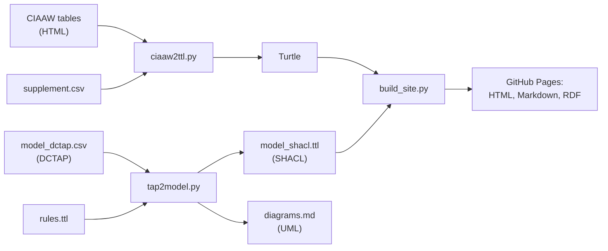

# CIAAW isotopic abundances and atomic weights as RDF (draft)

> **Prototype.** This is a suggestion for discussion, not an official CIAAW/IUPAC product, and neither has endorsed it.
> The model and IRIs are placeholders. We would like to work with the CIAAW
> on this; please open an issue with comments or questions.
> For values you intend to use, go to [ciaaw.org](https://ciaaw.org).

The scripts convert the tables on [ciaaw.org](https://ciaaw.org) into Turtle, following the
draft declaration model from issue 20: every published value is its own declaration with a
`qudt:QuantityValue`, and elements and isotopes keep stable IRIs that point to the current
declaration and its history.

**[View the prototype site](https://hendrikborgelt.github.io/Draft_for_IUPAC_CIAAW-Isotopic-Abundances-and-Atomic-Weights/)**

## We would like to hear from you

**Please [open an issue](https://github.com/HendrikBorgelt/Draft_for_IUPAC_CIAAW-Isotopic-Abundances-and-Atomic-Weights/issues/new)** with questions, corrections or ideas. You don't need to know RDF to help. All of these are useful:

- A value, footnote or term that looks wrong
- Something in the model that does not match how CIAAW thinks about its data
- A use case that this design would not support
- Experience with related work, such as other chemical or metrological linked data

## Working with CIAAW

We want to develop this together with the Commission. Decisions about the content, the identifiers and any eventual publication belong to CIAAW. The site is styled after ciaaw.org only to show how the idea could fit into the existing website, and every page carries a watermark saying that it is a prototype. If you are involved with CIAAW, we would be glad to hear from you.

## Files

| File | Purpose |
|---|---|
| `ciaaw2ttl.py` | CIAAW HTML tables → Turtle |
| `supplement.csv` | What the tables lack: report year, DOI, ChEBI matches |
| `ttl2quickstatements.py` | Turtle → QuickStatements CSV for Wikidata (isotope abundances only) |
| `ttl2sssom.py` | Turtle → SSSOM mappings of the elements and isotopes to Wikidata and ChEBI |
| `check_wikidata.py` | Compares the abundances in the Turtle with Wikidata |
| `tap2model.py` | DCTAP → SHACL shapes and UML diagrams |
| `model/` | The data model, see [below](#the-data-model) |
| `build_site.py`, `site/` | Static site for GitHub Pages |
| `sparql/queries/` | Example SPARQL queries, shown on the SPARQL tab and published as `.rq` files |
| `sparql/examples/` | The same queries as sparql-examples Turtle, made by `make sparql-examples` |
| `update_references.js`, `site/references.json` | The formatted sources for the Bibliography |
| `check_wikidata.py`, `site/wikidata-comparison.json` | The comparison with Wikidata, shown in the Comparison section of the site |
| `check_bodr.py`, `site/bodr-comparison.json` | The comparison with BODR, shown in the Comparison section |
| `wikidata_links.py`, `site/wikidata.csv` | The Wikidata items linked from the element pages |
| `test_*.py`, `fixtures/` | Tests and their small hand-built input tables |
| `ciaaw.ttl` | The full data, published on the site and loaded by the SPARQL endpoint |
| `example-output*.ttl` | Small example results, used by the tests and the revision example |
| `Makefile` | Runs the steps below |
| `AUTHORS` | The people who worked on the hackathon, with their ORCID |

## How it fits together



## Creating the Turtle

1. **Install the dependencies** (Python 3.11+): `make install`
2. **Download the two CIAAW pages** with `make download`, which saves them into `data/` as they
   are (or save them yourself from the browser):
   - <https://ciaaw.org/atomic-weights.htm> → `data/atomic-weights.htm`
   - <https://ciaaw.org/isotopic-abundances.htm> → `data/isotopic-abundances.htm`
3. **Check `supplement.csv`** (`subject,role,year,doi,chebi`). Roles are `standard`,
   `abundance` and `match` (a `skos:closeMatch` to ChEBI). An element symbol with role
   `abundance` applies to all its isotopes.
4. **Run `make ttl`**. The result is `ciaaw.ttl`. The script reports unparsable cells as
   `ERROR` lines and exits non-zero; use `--lenient` when calling it directly to ignore that.
   Expect 118 elements, 289 isotopes, and 26 warnings for elements 93 to 118, which the abundance
   table does not list. Check any other warning: a wrong sum means that isotopes went missing,
   even if the script exits normally.

Run `make help` to list all targets. If your Python command is `python` instead of `python3`,
add `PYTHON=python` to each command.

To try this without network access, `make example` builds the example files in `build/` from
the test fixtures.

### A new release

To keep the history of changed values, pass the Turtle of the earlier release:

```
make ttl PREVIOUS=ciaaw.ttl
```

Declarations whose value changed are kept, flagged `owl:deprecated`, and linked with
`dcterms:isReplacedBy` / `dcterms:replaces`.

### Options

Other options of `ciaaw2ttl.py` (`--iri-style hash`, `--data-ns`, `--vocab-ns`, `--no-vocab`)
are described by `python3 ciaaw2ttl.py --help`. Call the script directly to use them.

## Wikidata (optional)

`make quickstatements` writes `build/quickstatements.csv` for import with
[QuickStatements](https://quickstatements.toolforge.org/). It follows the model: the abundance of the
current declaration (`ciaaw:currentAbundance`, not the deprecated ones) as a natural abundance (P2374), with
the year of the declaration as qualifier (P585) and its DOI as reference (S356). The amounts are fractions
without unit, because that is how Wikidata stores P2374 (0.0107 for carbon-13), not percentages.

- Isotopes that Wikidata already has (`site/wikidata.csv`, see below) are **not created again**.
- An isotope without an item becomes a new item, with atomic number (P1086) and number of neutrons (P1148),
  which are the properties Wikidata uses for isotopes.
- With the JSON of `check_wikidata.py` (see below), `make quickstatements QS_COMPARISON=build/wikidata-comparison.json`
  also adds the abundance to the existing items that have none. Items where Wikidata has a different value
  are left alone, they need a person to decide.

Atomic weights and half-lives are not exported: Wikidata has no agreed property for an interval of standard
atomic weights.

## Mappings (SSSOM)

`make sssom` writes `build/ciaaw.sssom.tsv`, the mappings of the elements and isotopes to other resources as an
[SSSOM](https://mapping-commons.github.io/sssom/) mapping set (SSSOM/TSV: a YAML header in comment lines, then
one row per mapping). `ttl2sssom.py` writes:

| Mapping | Predicate | Justification |
|---|---|---|
| Element or isotope → Wikidata item, from `site/wikidata.csv` (found by atomic number, and number of neutrons for isotopes) | `skos:exactMatch` | `semapv:UnspecifiedMatching`, with the rule in `curation_rule_text` |
| Element or isotope → ChEBI, the `skos:closeMatch` in the Turtle (from `supplement.csv`) | `skos:closeMatch` | `semapv:ManualMappingCuration` |

Each row has the labels and categories of both sides. The header has the required `mapping_set_id` and `license`,
the `curie_map`, and the ORCIDs of the [AUTHORS](AUTHORS) as `creator_id`. The license is CC0 for the mappings
only, not for the CIAAW values; change it with `--license`. The `mapping_set_id` is the address where the site
publishes the file, `data/ciaaw.sssom.tsv`: `make site` writes it from the site data, and the Downloads page links
to it. Other options are `--mapping-set-version` and `--wikidata`.

## Comparing with Wikidata

`make check-wikidata` queries Wikidata with SPARQL (items with atomic number P1086 and number of
neutrons P1148, with natural abundance P2374) and compares the current abundances in `ciaaw.ttl` with them, in
percent. Isotopes are matched by atomic number Z and neutron number N (mass number = Z + N). Differences go
to STDOUT, a summary to STDERR:

```
DIFFERENT     hydrogen-2      local [0.001, 0.028]  Q2 wikidata 0.0115
NO-VALUE      helium-3        local 0.0002~0.0002  Q3 has no abundance
NOT-FOUND     argon-36        local ...  no Wikidata item
ONLY-RESOURCE ...             Wikidata has an abundance, the local data has not
```

Deprecated-rank statements are skipped. Each Wikidata value also comes with the sources of its references,
the "stated in" (P248) item and its DOI (P356) if it has one, shown at the end of the line and as `sources` in the
JSON. At the moment all the abundances in Wikidata cite NuDat (Q21234191), a database without a DOI, so the
comparison page links that item instead. Sources with a DOI get a Bibliography on the page.

Call `python3 check_wikidata.py --help` for `--strict` (exit 1 on differences) and
`--sparql-json` (use saved results, no network), and
`--json FILE` (also write the differences as JSON).

`make wikidata-comparison` writes that JSON for the site data to `site/wikidata-comparison.json`. It
is committed, so the build and the tests work offline, and `make serve` shows it on the
"Comparison" section of the site. Refresh it with `make wikidata-comparison`.

## Comparing with BODR

`make bodr-comparison` compares the abundances with the [Blue Obelisk Data Repository](https://github.com/egonw/bodr)
([doi:10.1186/1758-2946-3-37](https://doi.org/10.1186/1758-2946-3-37)), using `isotopes.xml` of the Debian
package `bodr` (`sudo apt install bodr`, or give the file with `--bodr`). BODR gives no uncertainty, so a
local value must equal the BODR value, and for a local interval the BODR value must fall within it. The result
is written to STDOUT in the same format as for Wikidata, and the JSON to `site/bodr-comparison.json` for the
Comparison section of the site. `check_bodr.py` has `--strict` and `--json` as well.

## Tests

```
make test
```

| Test file | What it covers |
|---|---|
| `test_ciaaw2ttl.py` | Reading the tables, number handling, the deprecation chain |
| `test_model.py` | The DCTAP, and that each SHACL rule rejects data broken on purpose |
| `test_check_bodr.py` | The comparison with BODR, on a small isotopes file |
| `test_quickstatements.py` | The QuickStatements export: properties, units, no duplicate items |
| `test_sssom.py` | The SSSOM header and table, the CURIEs, and the mappings of hydrogen |
| `test_site.py` | The pages, the watermark, links, and that every RDF format holds the same triples |
| `test_sparql.py` | The example queries on Oxigraph, the SPARQL page and the deployment setup |
| `test_published_data.py` | `ciaaw.ttl` and the site built from it, including that nothing is out of date |

## The site

`make serve` builds `_site/` and serves it on <http://localhost:8000>. `make site` only builds
it. To show other data, use for example `make site SITE_DATA=example-output.ttl`.

Every resource has a page, and its IRI is the address of that page:

| Prefix | Resources | Example IRI | Page | Turtle |
|---|---|---|---|---|
| `element:` | Elements | `element:Hydrogen` | `elements/Hydrogen` | `elements/Hydrogen.ttl` |
| `ciaaw_draft:` | Isotopes and declarations | `ciaaw_draft:H-1` | `id/H-1` | `id/H-1.ttl` |

GitHub Pages serves `id/H-1.html` at `id/H-1`, which is what makes these IRIs resolve. It cannot choose a
format per request, so an IRI always opens the page. The page links to the Turtle, shows it, and names it in
`<link rel="alternate">`, and software can also add `.ttl` to the IRI. `make serve` does not drop the `.html`,
so on your own machine an IRI only resolves if you add it.

The element pages link to Wikidata, for the element and for each isotope. The Q-numbers are in
`site/wikidata.csv`, which is committed so that the build and the tests work offline. Refresh it
with `make wikidata-links` (`wikidata_links.py`): elements are found by atomic number, isotopes by
atomic number and number of neutrons. When Wikidata has several items for one isotope, the one with a
natural abundance is used, and the script reports these cases.

Each element page ends with a Bibliography of the DOIs in `dcterms:source` of its declarations.
They are formatted as APA by [citation.js](https://citation.js.org), the way the author's blog does it:
`make references` (`update_references.js`, needs Node.js; if the system npm fails use
`make references NPM="node path/to/npm-cli.js"`) looks up the DOIs that are not yet in
`site/references.json`, including the DOIs of the sources in `site/*-comparison.json`. That file is committed, so the build and the tests work offline. A DOI that is
not in it is listed as the bare DOI.

Each push to `main` runs the tests and publishes the site through
[pages.yml](.github/workflows/pages.yml). Pull requests run the tests and build the site
without publishing it.

## The SPARQL endpoint

The endpoint is running at <https://ciaaw-draft.jerven-bolleman.workers.dev/sparql>, hosted by
Jerven Bolleman. The SPARQL tab on the site has a query editor, where each example opens in its
own tab, and shows the example queries with results computed with Oxigraph, the same engine.
The queries are also published as `.rq` files. From the command line:

```
curl -H 'Accept: text/turtle' --data-urlencode 'query=CONSTRUCT { ?s a ?o } WHERE { ?s a ?o }' https://ciaaw-draft.jerven-bolleman.workers.dev/sparql
```

It uses
[oxigraph-cloudflare-webworker](https://github.com/JervenBolleman/oxigraph-cloudflare-webworker),
a Cloudflare Worker that loads `data/combined.ttl` from the published site into an in-memory
Oxigraph store. That file holds the data and the example queries, and `make site` writes it. If
it is missing, every query fails with error 502. The site finds the endpoint through
`SPARQL_ENDPOINT` in `build_site.py`.

The Turtle in `sparql/examples` comes from the `.rq` files with
[sparql-examples-utils](https://github.com/sib-swiss/sparql-examples-utils). Run `make sparql-examples`
after changing a query. It needs the jar of that project, see `SPARQL_EXAMPLES_JAR` in the Makefile.

The worker's code is not copied here: `make` checks out the commit pinned in `WORKER_REF`. You
need Node.js for the two targets below.

To run it on your own machine, without a Cloudflare account:

```
make sparql-dev
```

Then query <http://localhost:8787/sparql>. To try the query editor on the SPARQL tab as well, build the site with
`make site SPARQL_ENDPOINT=http://localhost:8787/sparql`.

The running endpoint is deployed separately from this repository. To deploy from here instead:

1. Create a Cloudflare API token with only **Account → Workers Scripts → Edit**.
2. In the repository settings, add it as the secret `CLOUDFLARE_API_TOKEN`. Add
   `CLOUDFLARE_ACCOUNT_ID` too if the token can reach more than one account.
3. Set the repository variable `SPARQL_DEPLOY` to `true`.
4. Run the workflow again. From then on, each push to `main` publishes the site and then
   redeploys the worker, which makes it load the new data.

A token for another Cloudflare account creates a separate worker at a different address, so
`SPARQL_ENDPOINT` in `build_site.py` then has to change too.

Things to know:

- **Decimals are normalised.** Oxigraph returns `162.500` as `162.5` and `0.0000` as `0`. Use
  `ciaaw:significantFigures` or the Turtle file when the printed digits matter. Zero bounds have
  no significant figures, so their printed form is only in the Turtle file.
- **`CONSTRUCT` and `DESCRIBE` need an RDF format in the `Accept` header**, for example
  `text/turtle`. Without one, the endpoint answers with error 400.
- **New data is not picked up straight away.** The worker loads the Turtle once per instance, so
  it can keep serving older data after the site changes, until it restarts or is redeployed.
- **CPU limits have not been a problem so far.** The free Cloudflare plan allows 10 ms of CPU per
  request, but the running worker has answered queries that used about 460 ms. Loading the full
  data takes roughly 15 ms, only when a worker starts. The plan of the running worker is not
  known, so keep example queries cheap: `test_published_data.py` checks this.
- **Only the current data and the example queries are loaded.** The revision example is left
  out, so its invented value cannot appear in results.

## Without make

`make` is usually not installed on Windows. These commands do the same thing:

| Target | Command |
|---|---|
| `make install` | `python -m pip install -r requirements.txt` |
| `make ttl` | `python ciaaw2ttl.py --weights data/atomic-weights.htm --abundances data/isotopic-abundances.htm --supplement supplement.csv -o ciaaw.ttl` |
| `make quickstatements` | `python ttl2quickstatements.py ciaaw.ttl -o quickstatements.csv` |
| `make sssom` | `python ttl2sssom.py ciaaw.ttl -o ciaaw.sssom.tsv` |
| `make test` | `python -m pytest -q` |
| `make model` | `python tap2model.py` |
| `make validate` | `python tap2model.py --validate ciaaw.ttl example-output-next.ttl` |
| `make site` | `python build_site.py` and `python combine_sparql_examples.py -o _site/data/combined.ttl` |

For `make download`, save the two pages from your browser as described in step 2 above.

## The data model

The model is written once, as a [DCTAP](https://www.dublincore.org/specifications/dctap/) table
in [model/model_dctap.csv](model/model_dctap.csv). The
[PubChemRDF schema](https://pubchem.ncbi.nlm.nih.gov/docs/rdf-schema) works the same way, and
other formats such as ShEx or LinkML can be derived from the same table.

| File | Purpose | Edit it? |
|---|---|---|
| [model/model_dctap.csv](model/model_dctap.csv) | The model | Yes |
| [model/dctap.yaml](model/dctap.yaml) | Prefixes, extra columns and diagram aspects | Yes |
| [model/rules.ttl](model/rules.ttl) | Rules that compare several nodes, which a DCTAP row cannot express | Yes |
| [model/model_shacl.ttl](model/model_shacl.ttl) | SHACL shapes | No, generated |
| [model/diagrams.md](model/diagrams.md) | One UML diagram per aspect | No, generated |

After changing the model, run `make model`. The tests fail if the generated files are out of date.

The table adds four columns to the 12 DCTAP elements, all declared in `dctap.yaml`:
`targetClass`, `extends`, `closed` and `aspect`.

## Current limits

- **`ciaaw.ttl` is a snapshot.** It was made from the CIAAW pages on 5 November 2026 and does not follow their updates. To refresh it, run `make download` and `make ttl`, then `make wikidata-comparison` and `make bodr-comparison`, because the tests check that those match the data.
- **Years and DOIs are only known for hydrogen.** All other declarations have no citation yet. Adding a year later also changes the declaration's IRI, so `supplement.csv` should be completed before anyone cites them.
- **`example-output-next.ttl` contains an invented value.** It demonstrates a revision of hydrogen and is not a CIAAW value.
- **All IRIs are placeholders** until a persistent home is agreed. The data IRIs resolve on GitHub Pages, but the vocabulary (`ciaaw:`) is still on `example.org` and does not resolve.
- **Atomic masses and abridged values are modelled but not generated**, because the two source tables do not contain them.
- **The ADMS status IRI has not been confirmed yet.** See the note in `ciaaw2ttl.py`.
- **No licence has been chosen yet** for the code or the data.
