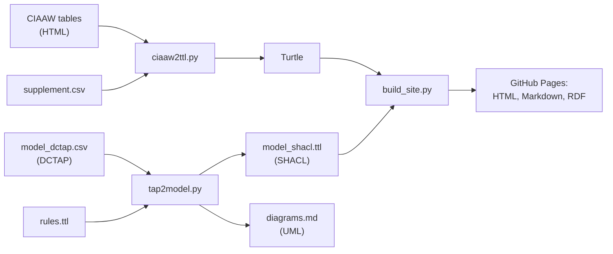

# CIAAW isotopic abundances and atomic weights as RDF (draft)

> **Prototype.** This is a suggestion for discussion, not an official CIAAW/IUPAC product, and neither has endorsed it.
> The model and IRIs (`example.org`) are placeholders. We would like to work with the CIAAW
> on this; please open an issue with comments or questions.
> For values you intend to use, go to [ciaaw.org](https://ciaaw.org).

The scripts convert the tables on [ciaaw.org](https://ciaaw.org) into Turtle, following the
draft declaration model from issue 20: every published value is its own declaration with a
`qudt:QuantityValue`, and elements and isotopes keep stable IRIs that point to the current
declaration and its history.

**[View the prototype site](https://hendrikborgelt.github.io/Draft_for_IUPAC_CIAAW-Isotopic-Abundances-and-Atomic-Weights/)**

## We would like to hear from you

**Please [open an issue](https://github.com/HendrikBorgelt/Draft_for_IUPAC_CIAAW-Isotopic-Abundances-and-Atomic-Weights/issues/new)** with questions, corrections or ideas. You don't need to know RDF to help. All of these are useful:

- A value, footnote or term that looks wrong
- Something in the model that does not match how CIAAW thinks about its data
- A use case that this design would not support
- Experience with related work, such as other chemical or metrological linked data

## Working with CIAAW

We want to develop this together with the Commission. Decisions about the content, the identifiers and any eventual publication belong to CIAAW. The site is styled after ciaaw.org only to show how the idea could fit into the existing website, and every page carries a watermark saying that it is a prototype. If you are involved with CIAAW, we would be glad to hear from you.

## Files

| File | Purpose |
|---|---|
| `ciaaw2ttl.py` | CIAAW HTML tables → Turtle |
| `supplement.csv` | What the tables lack: report year, DOI, ChEBI matches |
| `ttl2quickstatements.py` | Turtle → QuickStatements CSV for Wikidata (isotope abundances only). **Not in this repository yet** |
| `tap2model.py` | DCTAP → SHACL shapes and UML diagrams |
| `model/` | The data model, see [below](#the-data-model) |
| `build_site.py`, `site/` | Static site for GitHub Pages |
| `test_*.py`, `fixtures/` | Tests and their small hand-built input tables |
| `example-output*.ttl` | Example results |
| `Makefile` | Runs the steps below |

## How it fits together



## Creating the Turtle

1. **Install the dependencies** (Python 3.11+): `make install`
2. **Download the two CIAAW pages** with `make download`, which saves them into `data/` as they
   are (or save them yourself from the browser):
   - <https://ciaaw.org/atomic-weights.htm> → `data/atomic-weights.htm`
   - <https://ciaaw.org/isotopic-abundances.htm> → `data/isotopic-abundances.htm`
3. **Check `supplement.csv`** (`subject,role,year,doi,chebi`). Roles are `standard`,
   `abundance` and `match` (a `skos:closeMatch` to ChEBI). An element symbol with role
   `abundance` applies to all its isotopes.
4. **Run `make ttl`**. The result is `build/ciaaw.ttl`. The script reports unparsable cells as
   `ERROR` lines and exits non-zero; use `--lenient` when calling it directly to ignore that.

Run `make help` to list all targets. If your Python command is `python` instead of `python3`,
add `PYTHON=python` to each command.

To try this without network access, `make example` builds the example files in `build/` from
the test fixtures.

### A new release

To keep the history of changed values, pass the Turtle of the earlier release:

```
make ttl PREVIOUS=ciaaw-2022.ttl
```

Declarations whose value changed are kept, flagged `owl:deprecated`, and linked with
`dcterms:isReplacedBy` / `dcterms:replaces`.

### Options

Other options of `ciaaw2ttl.py` (`--iri-style hash`, `--data-ns`, `--vocab-ns`, `--no-vocab`)
are described by `python3 ciaaw2ttl.py --help`. Call the script directly to use them.

## Wikidata (optional)

`make quickstatements` writes `build/quickstatements.csv`, one new item per isotope, for
import with [QuickStatements](https://quickstatements.toolforge.org/). Atomic weights are not
exported yet.

Note: `ttl2quickstatements.py` is not in this repository yet, so this target fails until the
script is added.

## Tests

```
make test
```

| Test file | What it covers |
|---|---|
| `test_ciaaw2ttl.py` | Reading the tables, number handling, the deprecation chain |
| `test_model.py` | The DCTAP, and that each SHACL rule rejects data broken on purpose |
| `test_site.py` | The pages, the watermark, links, and that every RDF format holds the same triples |

## The site

`make serve` builds `_site/` and serves it on <http://localhost:8000>. `make site` only builds
it. To show your own data, use `make site SITE_DATA=build/ciaaw.ttl`.

Each push to `main` runs the tests and publishes the site through
[pages.yml](.github/workflows/pages.yml). Pull requests run the tests and build the site
without publishing it.

## Without make

`make` is usually not installed on Windows. These commands do the same thing:

| Target | Command |
|---|---|
| `make install` | `python -m pip install -r requirements.txt` |
| `make ttl` | `python ciaaw2ttl.py --weights data/atomic-weights.htm --abundances data/isotopic-abundances.htm --supplement supplement.csv -o ciaaw.ttl` |
| `make test` | `python -m pytest -q` |
| `make model` | `python tap2model.py` |
| `make validate` | `python tap2model.py --validate example-output.ttl example-output-next.ttl` |
| `make site` | `python build_site.py` |

For `make download`, save the two pages from your browser as described in step 2 above.

## The data model

The model is written once, as a [DCTAP](https://www.dublincore.org/specifications/dctap/) table
in [model/model_dctap.csv](model/model_dctap.csv). The
[PubChemRDF schema](https://pubchem.ncbi.nlm.nih.gov/docs/rdf-schema) works the same way, and
other formats such as ShEx or LinkML can be derived from the same table.

| File | Purpose | Edit it? |
|---|---|---|
| [model/model_dctap.csv](model/model_dctap.csv) | The model | Yes |
| [model/dctap.yaml](model/dctap.yaml) | Prefixes, extra columns and diagram aspects | Yes |
| [model/rules.ttl](model/rules.ttl) | Rules that compare several nodes, which a DCTAP row cannot express | Yes |
| [model/model_shacl.ttl](model/model_shacl.ttl) | SHACL shapes | No, generated |
| [model/diagrams.md](model/diagrams.md) | One UML diagram per aspect | No, generated |

After changing the model, run `make model`. The tests fail if the generated files are out of date.

The table adds four columns to the 12 DCTAP elements, all declared in `dctap.yaml`:
`targetClass`, `extends`, `closed` and `aspect`.

## Current limits

- **The site shows 8 of the 118 elements.** It is built from `example-output.ttl`, which came from a small hand-built copy of the tables.
- **The converter has not been checked against the live CIAAW pages yet.** Run `make download` and `make ttl`, then confirm that it reports 118 elements and no `ERROR` lines.
- **`example-output-next.ttl` contains an invented value.** It demonstrates a revision of hydrogen and is not a CIAAW value.
- **All IRIs under `example.org` are placeholders** until a persistent home is agreed.
- **Atomic masses and abridged values are modelled but not generated**, because the two source tables do not contain them.
- **The ADMS status IRI has not been confirmed yet.** See the note in `ciaaw2ttl.py`.
- **No licence has been chosen yet** for the code or the data.
- **A SPARQL endpoint is planned.** See [issue 1](https://github.com/HendrikBorgelt/Draft_for_IUPAC_CIAAW-Isotopic-Abundances-and-Atomic-Weights/issues/1).
