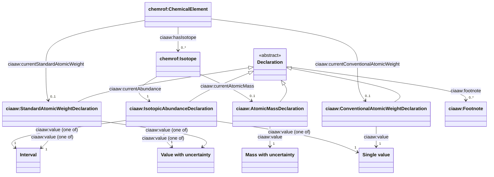
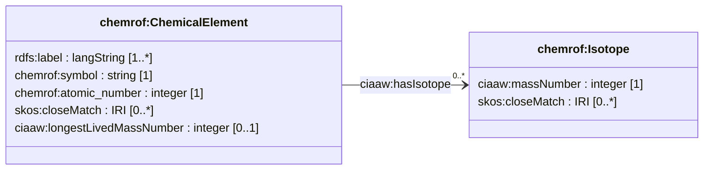
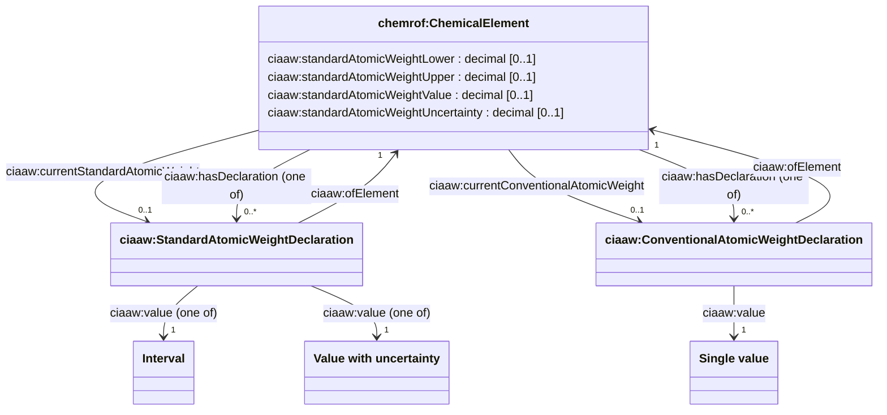
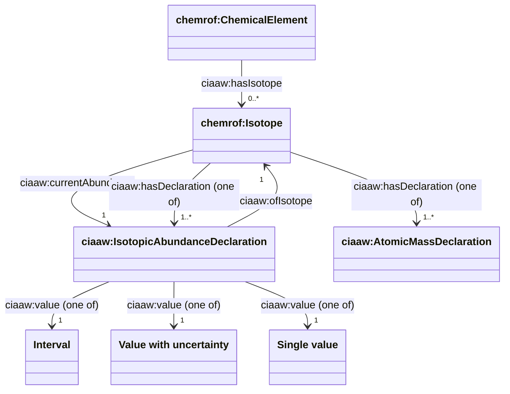
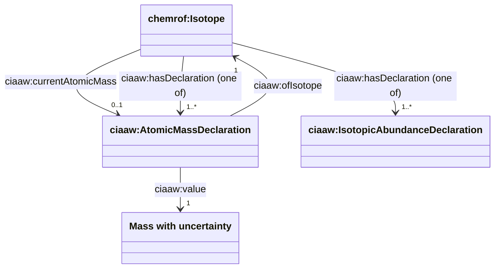
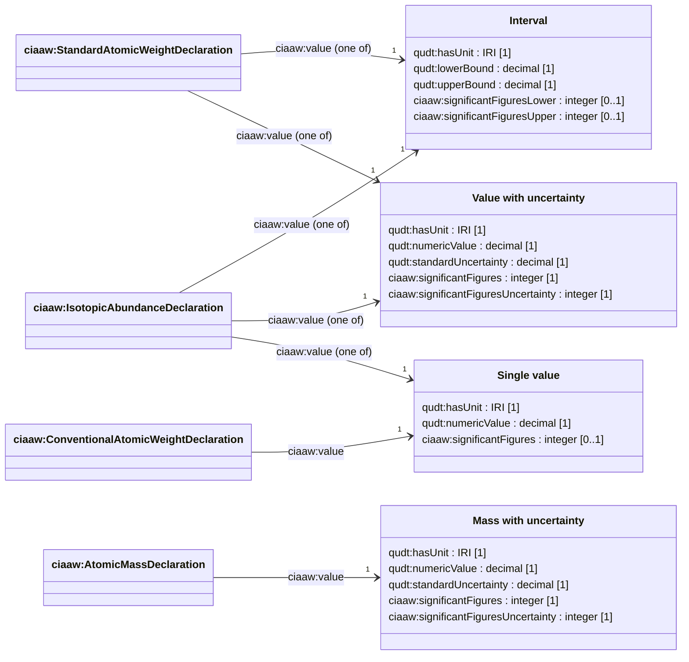
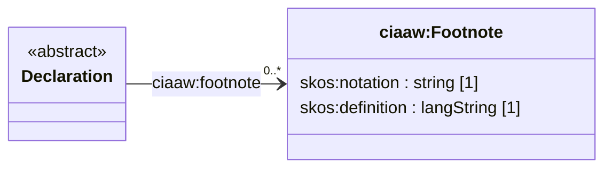
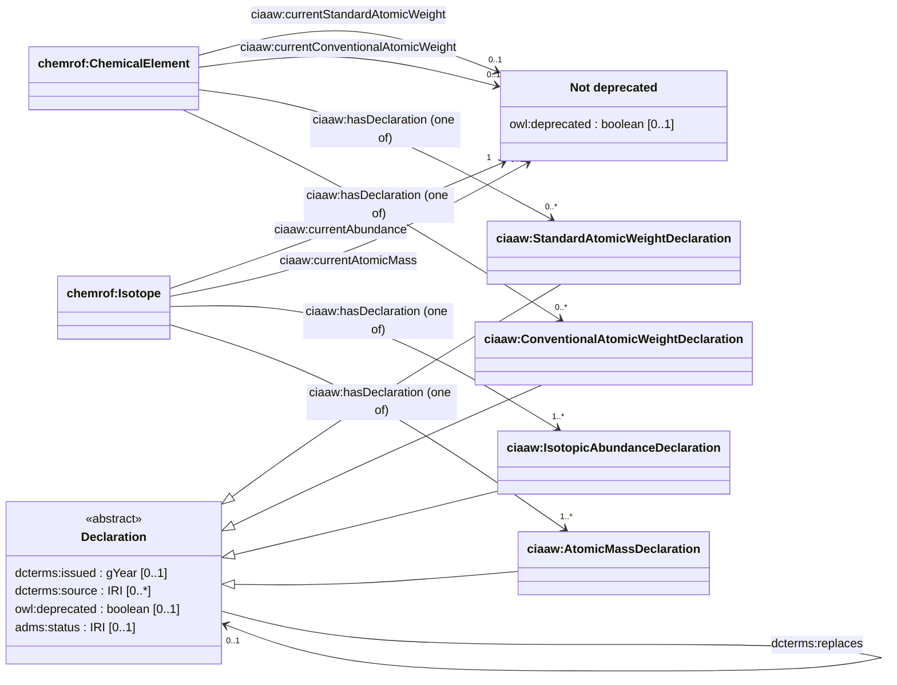

<!-- GENERATED by tap2model.py. Do not edit: change model/model_dctap.csv. -->

# Data model diagrams

Prototype, not an official CIAAW model. Generated from [model_dctap.csv](model_dctap.csv), one diagram per aspect.

## Overview

The main classes and how they connect. Attributes, back-references and history links are in the diagrams for each aspect.

## Elements and isotopes

Elements and isotopes keep a stable IRI. They hold identifying facts and pointers, while every published value lives in a separate declaration.

## Atomic weight declarations

A standard atomic weight is either an interval or a value with an uncertainty. The element points to the one current declaration and repeats its numbers as derived shortcuts.

## Isotopic abundance declarations

The representative isotopic composition of one isotope. It can be an interval, a value with an uncertainty, or a single value such as 1 for monoisotopic elements.

## Atomic masses (planned)

Part of the draft vocabulary, but not generated yet because the two source tables do not contain atomic masses.

## Quantity values

Numbers are qudt:QuantityValue nodes in one of a few closed forms. Significant figures are stored separately because xsd:decimal does not preserve trailing zeros.

## Footnotes

The g, m and r notes printed below the CIAAW tables are shared nodes that declarations refer to.

## History and provenance

Declarations are never edited. A new value creates a new declaration, and the old one is kept, flagged as deprecated, and linked to its replacement.

