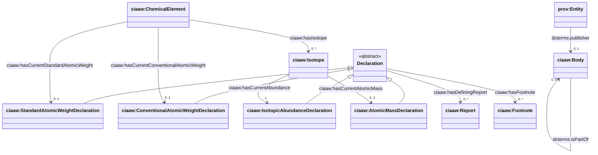
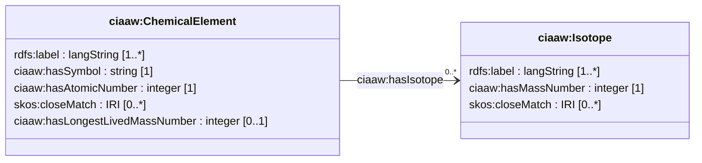
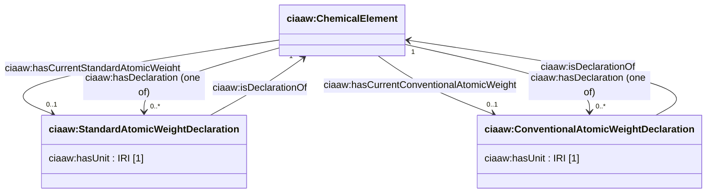
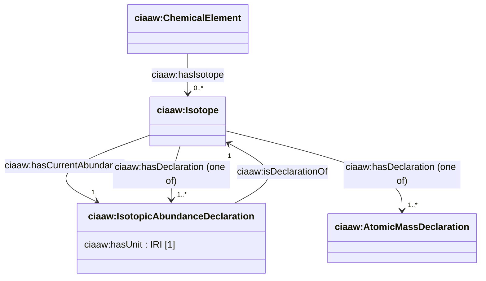
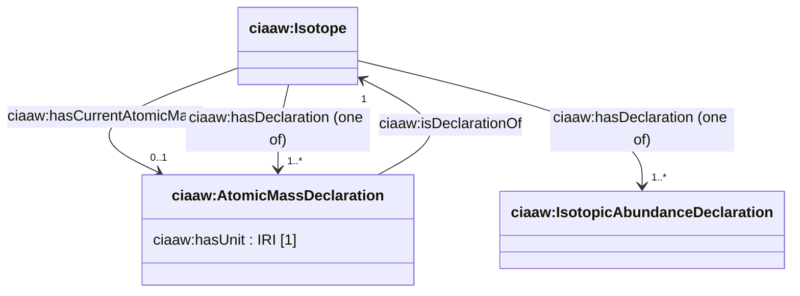
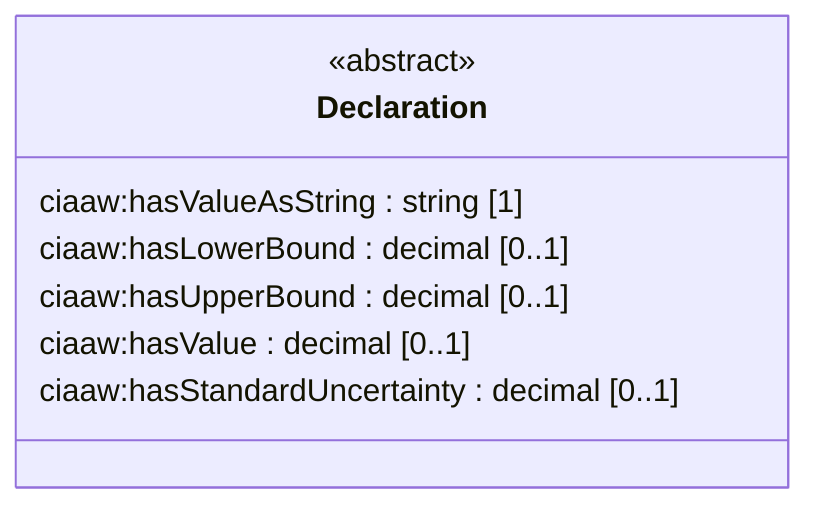
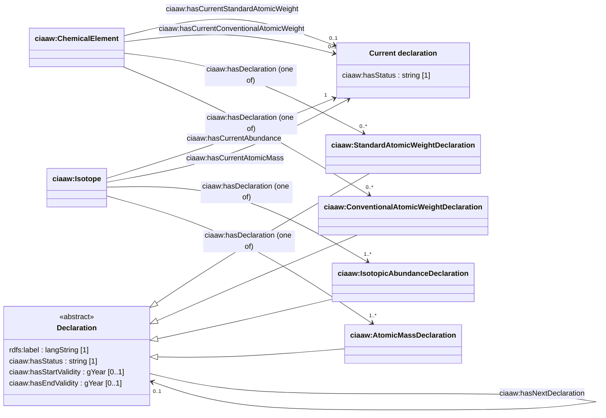
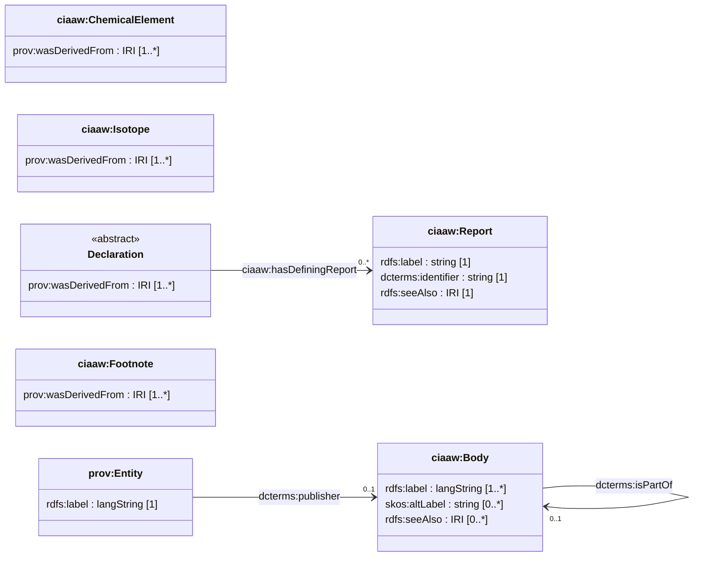
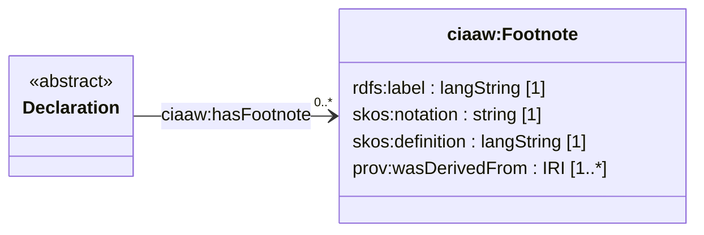

<!-- GENERATED by tap2model.py. Do not edit: change model/model_dctap.csv. -->

# Data model diagrams

Prototype, not an official CIAAW model. Generated from [model_dctap.csv](model_dctap.csv), one diagram per aspect.

## Overview

The main classes and how they connect. Attributes, back-references and history links are in the diagrams for each aspect.

## Elements and isotopes

Elements and isotopes keep a stable IRI. They hold identifying facts and pointers, while every published value lives in a separate declaration.

## Atomic weight declarations

The element points to all its standard atomic weight declarations and to the one that is current.

## Isotopic abundance declarations

The representative isotopic composition of one isotope: an interval, a value with an uncertainty, or a single value such as 1 for monoisotopic elements.

## Atomic masses (planned)

Part of the draft vocabulary, but not generated yet because the two source tables do not contain atomic masses.

## Values

A declaration holds its numbers itself, without a separate node: an interval, a value with its standard uncertainty, or a value alone, and always the value as CIAAW prints it, which keeps the significant figures.

## History

Declarations are never edited. A new value creates a new declaration with the status current; the old one becomes superseded, gets the year it ended, and the two are linked, as definitions are in the SI Reference Point.

## Provenance

Every element, isotope and declaration names the documents it was read from, and a declaration names the report in which CIAAW published it.

## Footnotes

The g, m and r notes printed below the CIAAW tables are shared resources that declarations refer to.

